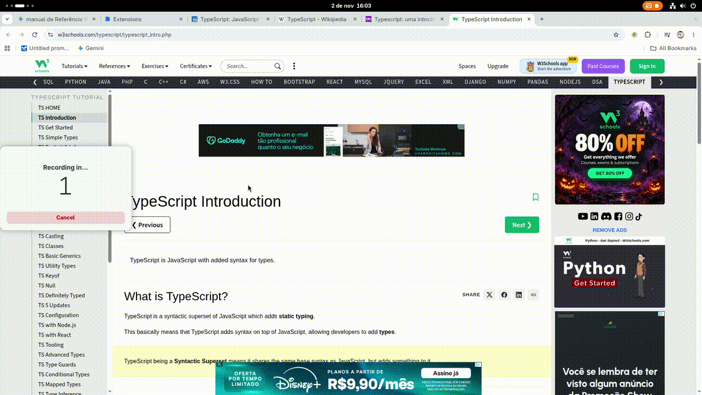

# 📌 Leads Tracker — Chrome Extension (Manifest V3)

> A modular Google Chrome extension designed to save, organize, and filter URLs and active tabs in real-time, with secure data persistence.


---



---

## 🚀 Features

- **Instant Tab Saving:** Captures the URL and official title of the active tab using the `chrome.tabs` API.
- **Manual Input with Validation:** Normalizes protocols (`https://`), validates domains via the native `URL` constructor, and removes trailing slashes to prevent duplicates.
- **Real-time Filtering:** Instant, simultaneous search across both titles and URLs.
- **Resilient Persistence:** An abstraction layer over `localStorage` that includes exception handling (`try...catch`), recovery from corrupted JSON, and safeguards against storage quota limits (`QuotaExceededError`).
- **Modular Architecture:** Clear separation of concerns using native ES Modules.

---

## 🏛️ Project Structure

The project was built following **Single Responsibility Principle (SRP)** and features decoupled layers:

- `js/main.js`: The extension orchestrator, handling event listeners and the application lifecycle.
- `js/validation.js`: A module containing pure functions for URL sanitization and validation.
- `js/render.js`: The UI layer responsible for the dynamic construction of DOM elements.
- `js/storage.js`: An abstraction layer for `localStorage` persistence, including error handling. 

---

## 🛠️ Technologies Used

- **JavaScript (ES6+)** — ES Modules (`import`/`export`)
- **HTML5 & CSS3** — Responsive interface built using Flexbox
- **Chrome Extension API** — `chrome.tabs` (Manifest V3)

---

## 🔧 How to Run Locally

### 1. Clone the repository

```bash
git clone [https://github.com/your-username/leads-tracker.git](https://github.com/your-username/leads-tracker.git)
cd leads-tracker
```

### 2. Load Extension on Chrome

- Open browser and access chrome://extensions/

- Activate **Developer Mode** (Upper-Right corner)

- Click on Load unpacked

- Select the src/ folder

- Activate extension (if not already)
